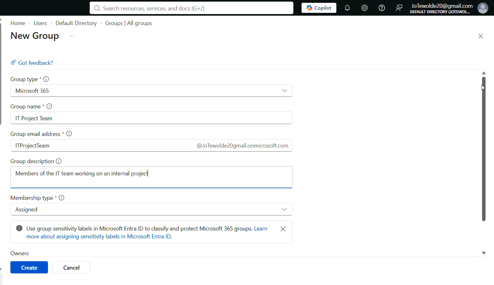

# 03 - Group Management

## Overview

Groups are an important part of identity and access management in **Microsoft Entra ID**. Instead of assigning permissions and access to individual users, administrators can use groups to organize users and manage access more efficiently.

In this section of the Microsoft Entra ID homelab, I practiced creating different types of groups, adding members, configuring dynamic group membership, assigning group owners, and reviewing group-based licensing.

The lab was based on Microsoft's official [Perform Basic Group Management Tasks](http://microsoftlearning.github.io/Get-started-Microsoft-Entra-Management-Tasks/Instructions/Labs/02-perform-basic-group-management.html) exercise and adapted for this homelab environment. Instead of using the example users provided by Microsoft, I created fictional users to simulate a small organization.

---

## Objectives

The objectives of this lab are to:

- Understand the purpose of groups in Microsoft Entra ID.
- Create a Microsoft 365 group.
- Create a Security group.
- Add users to groups.
- Understand assigned and dynamic group membership.
- Create a dynamic group based on user properties.
- Manage group owners.
- Understand group-based licensing.
- Practice group administration tasks relevant to IT Support and Identity Administration roles.

---

## Step 1: Create a Microsoft 365 Group

Microsoft 365 groups are used for collaboration, giving members access to a shared mailbox, calendar, files, SharePoint site, and so on. Group members can only be users.

1. Connect to the [Microsoft Entra Admin Center](https://entra.microsoft.com/).
2. Navigate to **Groups → All groups** and select the **"New Group"** option to create a new group.
3. Configure the group using the following settings:
    - **Group Type**: Microsoft 365
    - **Group Name**: IT Project Team
    - **Group Email Address**:ITProjectTeam@DomainEmail.com
    - **Group Description**: Members of the IT team working on an internal project.
    - **Membership Type**: Assigned
4. Under the **Members** heading on the form, click on the **No members selected** hyperlink.
5. Add any user that you have into the group by marking the box next to their name and choosing the **Select** button.
6. Select the **Create** button to finalize the group creation.

After creating the group, I verified that the new Microsoft 365 group appeared under **Groups → All groups**.

---

## Step 2: Create a Security Group