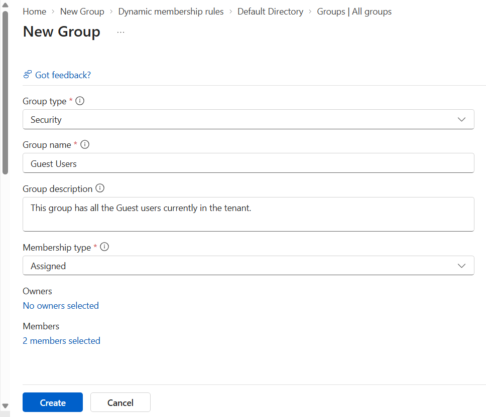
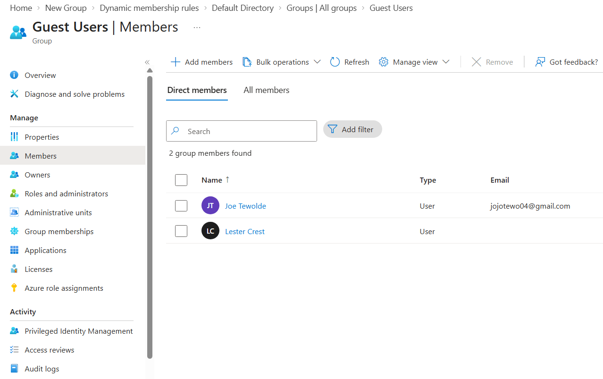
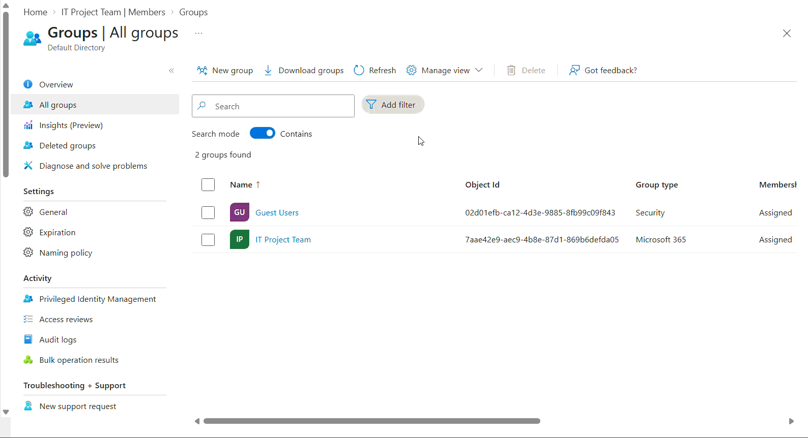
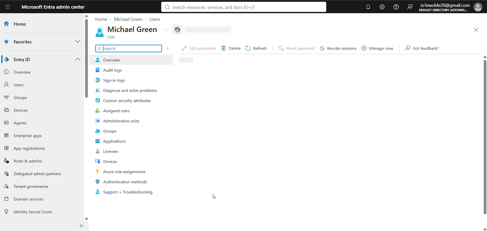
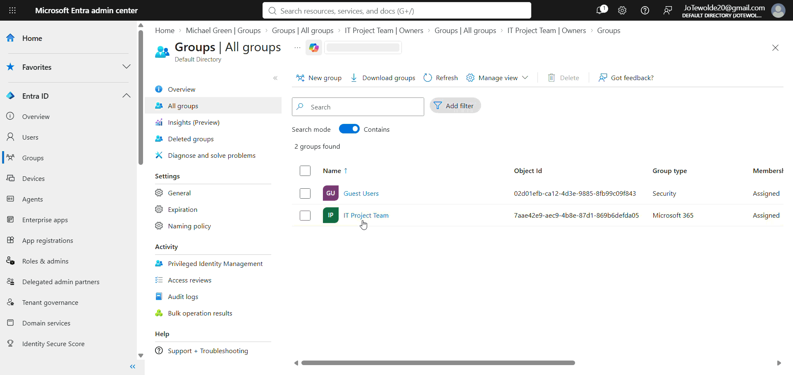

# 03 - Group Management

## Overview

Groups are an important part of identity and access management in **Microsoft Entra ID**. Instead of assigning permissions and access to individual users, administrators can use groups to organize users and manage access more efficiently.

In this section of the Microsoft Entra ID homelab, I practiced creating different types of groups, adding members, configuring dynamic group membership, assigning group owners, and reviewing group-based licensing.

The lab was based on Microsoft's official [Perform Basic Group Management Tasks](http://microsoftlearning.github.io/Get-started-Microsoft-Entra-Management-Tasks/Instructions/Labs/02-perform-basic-group-management.html) exercise and adapted for this homelab environment. Instead of using the example users provided by Microsoft, I created fictional users to simulate a small organization.

---

## Objectives

The objectives of this lab are to:

- Understand the purpose of groups in Microsoft Entra ID.
- Create a Microsoft 365 group.
- Create a Security group.
- Add users to groups.
- Understand assigned and dynamic group membership.
- Create a dynamic group based on user properties.
- Manage group owners.
- Understand group-based licensing.
- Practice group administration tasks relevant to IT Support and Identity Administration roles.

---

## Step 1: Create a Microsoft 365 Group

Microsoft 365 groups are used for collaboration, giving members access to a shared mailbox, calendar, files, SharePoint site, and so on. Group members can only be users.

1. Connect to the [Microsoft Entra Admin Center](https://entra.microsoft.com/).
2. Navigate to **Groups → All groups** and select the **"New Group"** option to create a new group.
3. Configure the group using the following settings:
    - **Group Type**: Microsoft 365
    - **Group Name**: IT Project Team
    - **Group Email Address**:ITProjectTeam@DomainEmail.com
    - **Group Description**: Members of the IT team working on an internal project.
    - **Membership Type**: Assigned
4. Under the **Members** heading on the form, click on the **No members selected** hyperlink.
5. Add any user that you have into the group by marking the box next to their name and choosing the **Select** button.
6. Select the **Create** button to finalize the group creation.

After creating the group, I verified that the new Microsoft 365 group appeared under **Groups → All groups**.

---

## Step 2: Create a Security Group

A **Security group** can be used to control access to resources and applications. Microsoft Entra ID also supports **dynamic membership**, which allows users to automatically become members of a group when they meet a defined rule.

1. Connect to the [Microsoft Entra Admin Center](https://entra.microsoft.com/).
2. Navigate to **Groups → All groups** and select the **"New Group"** option to create a new group.
3. Configure the group using the following settings:
    - **Group Type**: Security
    - **Group Name**: Guest Users
    - **Group Description**: This group has all the Guest users currently in the tenant.
    - **Membership Type**: Assigned
4. Under the **Members** heading on the form, click on the **No members selected** hyperlink.
5. Add any user that you have into the group by marking the box next to their name and choosing the **Select** button.
6. Select the **Create** button to finalize the group creation.

After creating the group, open the group and select Members to verify that the users were successfully added.

This demonstrates how an administrator can organize users into security groups for easier access management.

---

## Step 3: Add an Existing User to a Group

Administrators can add existing users to groups directly from the group's membership settings.

For this exercise, I added the external user created during the previous User Management lab to the Microsoft 365 group.

1. Navigate to **Groups → All groups** and select the group that you want to add the user to.
    - **Example:** IT Project Team
2. Select the **Members** option from the menu.
3. Select **"+ Add Members"** from the menu near the top.
4. Mark the box next to the user you want to add and use the Select button.
5. Click the **Refresh** button to verify that the user was successfully added to the group.

After adding the user, I verified that the account appeared in the group's member list.

### Alternative Method: 

Users can also be added to groups from the user management section.

1. Navigate to **Identity → Users → All users**.
2. Find and select the user that you want to add to a group.
3. Click on the **Groups** item from the menu.
4. Select the option to **+ Add memberships**.
5. Mark an existing group and use the Select button to add them.

This provides an alternative method for managing group membership directly from a user's account.

---

## Step 4: Manage Group Owners

Group owners are responsible for managing a group's membership and other group-related settings.

When creating a group without specifying an owner, the tenant administrator may automatically become the owner.

1. Navigate to **Groups → All groups** and select the group that you want to add an owner to.
    - **Example:** IT Project Team
2. Choose the **Owners** option from the menu.
    - **Note:** - Your tenant administrator will automatically be added as the owner of a group, if no owner is specified.
3. Select the **+ Add owners** menu item.
4. Mark the box next to the user you want to make an owner and use the **Select** button.
5. Notice the new owner has been added to the group.

The selected user now appears in the group's **Owners** list.

This demonstrated how group ownership can be delegated to another user instead of requiring the tenant administrator to manage every group.

---

## Lab Completion

After completing the group management exercises, I practiced the following Microsoft Entra ID tasks:

- [x] Created a Microsoft 365 group.
- [x] Created a Security group.
- [x] Created a dynamic membership rule.
- [x] Added users to a group.
- [x] Managed group membership from a user account.
- [x] Added a group owner.
- [x] Reviewed group-based licensing.
- [x] Verified dynamic group membership.

---

## Lessons Learned

This lab provided hands-on experience with using groups to organize and manage cloud identities in Microsoft Entra ID.

I learned how groups can simplify identity administration by allowing administrators to manage collections of users rather than configuring access for each user individually.

I also learned the difference between **Microsoft 365 groups** and **Security groups**, as well as how **dynamic membership** can automatically place users into groups based on user attributes.

These concepts are applicable to common **IT Support, Help Desk, System Administration, and Identity Administration** responsibilities involving user onboarding, access management, and permission administration.

---

## Reference

- [Microsoft Learn - Perform Basic Group Management Tasks](https://microsoftlearning.github.io/Get-started-Microsoft-Entra-Management-Tasks/Instructions/Labs/02-perform-basic-group-management.html)